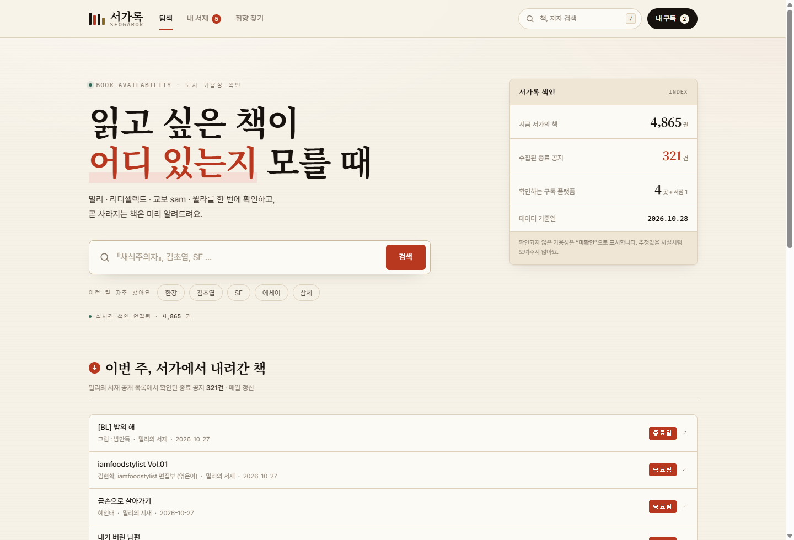
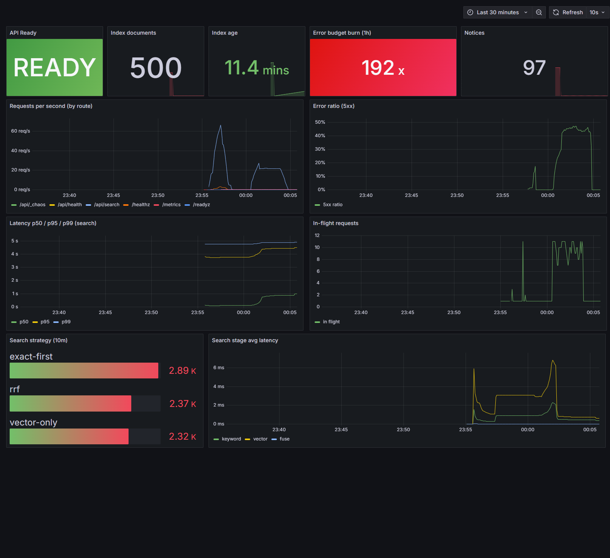
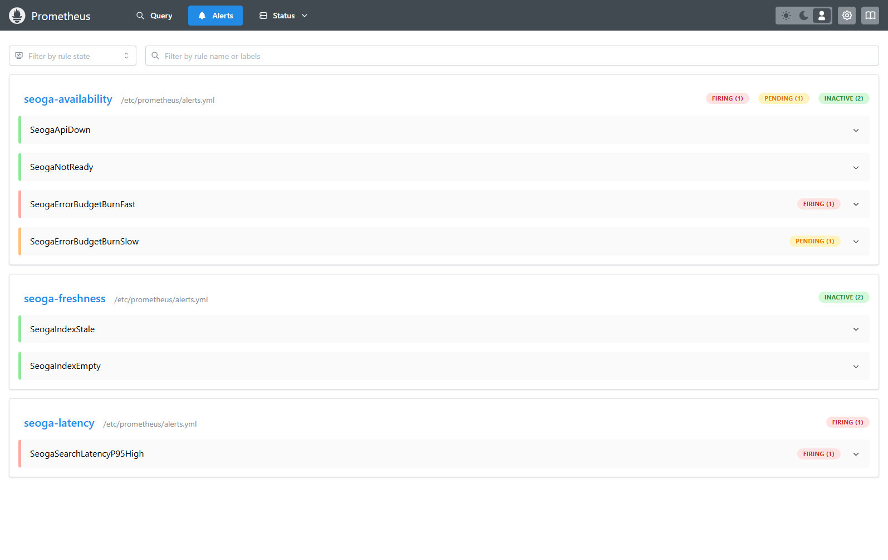

# 서가록 (SEOGAROK)

> **이 책, 지금 어느 서가에 있나** — 책의 가용성 레이어

**🟢 라이브:** https://seogarok.com (GCP Cloud Run · asia-northeast3 · scale-to-zero)
· 4,865권 실시간 인덱스 · 하이브리드 검색 p50 ~3ms · [약관/개인정보/출처](legal.html)

왓챠피디아의 책 버전. 단, 포지셔닝은 "추천 서비스"가 아니라 **"가용성(어디서 읽을 수 있나) + 종료 추적"**.



이 저장소는 두 층으로 구성됩니다.

| 층 | 내용 |
|---|---|
| **프론트엔드** | 다크 테마 SPA (`index.html` / `styles.css` / `app.js`) — 서버가 없으면 자동으로 로컬 데모 모드 |
| **백엔드** | Python 표준 라이브러리 + SQLite 검색 엔진 (`server/`) — BM25 + 벡터 하이브리드 |
| **수집** | 도서 카탈로그(`ingest/books/`), 종료 예정 공지(`ingest/notices/`) 파이프라인 |

---

## 빠른 실행

```powershell
cd C:\Dev\seoga
.\run.ps1            # 인덱스 없으면 생성 후 http://127.0.0.1:8100
.\run.ps1 -Reindex   # 카탈로그/공지 다시 읽어 재색인
.\run.ps1 -Bench     # 검색 벤치마크
```

수동으로 하려면:

```powershell
python -m server.sync                                  # data/catalog.jsonl (+ notices.jsonl) -> SQLite
python -m server.app --port 8100                       # API + 정적 서버
```

`index.html`을 그냥 열어도(file://) 프론트는 동작합니다. 이때는 `/api`가 없으므로
**로컬 데모 모드**(38권 큐레이션 + 규칙 기반 검색)로 폴백합니다.

---

## SRE / DevOps 계층 (관측성 · SLO · 게임데이)

이 저장소는 **SRE/DevOps 포트폴리오**로도 쓰도록 운영 계층이 붙어 있습니다.
"기능이 동작한다"가 아니라 **"장애를 어떻게 감지하고 대응하는가"** 를 코드·설정·문서로 닫았습니다.

| 계층 | 구현 | 확인 |
|---|---|---|
| **관측성** | `/metrics` (RED + 도메인 메트릭 15종), stdout JSON 로그(`req_id`), `/healthz`(liveness)·`/readyz`(readiness) 분리 | `curl localhost:8100/metrics` |
| **스택** | Docker Compose: `api` + Prometheus + Grafana(대시보드 **as code** 13패널) | Grafana http://localhost:3001/d/seogarok-sre |
| **SLO** | 가용성 99.9%(월 43m 12s), 검색 p95 < 300ms, 5xx < 1%, 인덱스 신선도 24h | [docs/SRE.md](docs/SRE.md) |
| **알림** | 멀티윈도우 멀티번레이트 7종 + 런북 링크 (`SeogaApiDown`, `SeogaErrorBudgetBurnFast` …) | http://localhost:9090/alerts |
| **장애 대응** | **카오스 주입 엔드포인트** → 알림 발화 → 복구. 런북 4종 + 포스트모템 | [docs/runbooks](docs/runbooks), [docs/postmortem](docs/postmortem) |
| **CI** | test(오프라인) → build + Trivy 스캔 → compose-smoke | [.github/workflows/ci.yml](.github/workflows/ci.yml) |
| **부하테스트** | k6, SLO를 threshold로 강제 | [loadtest/search.js](loadtest/search.js) |

```powershell
docker compose up -d --build          # api:8100 · prometheus:9090 · grafana:3001
docker compose --profile load run --rm k6 run /scripts/search.js   # 부하테스트
.\scripts\game_day.ps1 -Scenario all  # 카오스 주입 → 2~3분 뒤 알림 확인
.\scripts\game_day.ps1 -Scenario reset
```

**실측 (컨테이너 500권 인덱스, k6 25 VU × 50s)**

| 지표 | 값 |
|---|---|
| 검색 p95 / p99 | **4.10ms / 5.74ms** (SLO 300ms 대비 약 73배 여유) |
| 실패율 / checks | **0.00%** (0/2,844) / **100%** |
| 처리량 | **56.9 req/s** |
| 게임데이 | `SeogaSearchLatencyP95High` · `SeogaErrorBudgetBurnFast` **FIRING** (에러버짓 연소 192x) → 리셋 후 5초 내 복구 |

포트폴리오 관점 정리(이력서 bullet·5분 데모 시나리오)는 **[PORTFOLIO.md](PORTFOLIO.md)** 에 있습니다.

### 배포 — Terraform + Cloud Run 카나리

| 항목 | 내용 |
|---|---|
| **IaC** | [`terraform/`](terraform/) — Cloud Run v2 · Artifact Registry · **GitHub OIDC(WIF)** · 최소권한 IAM · scale-to-zero |
| **CD** | [deploy.yml](.github/workflows/deploy.yml) — build&push → **카나리(트래픽 0%)** → 스모크 → 100% 승격 → 실패 시 **자동 롤백** |
| **키 없는 배포** | 장기 서비스 계정 키 없음. OIDC 토큰을 배포 SA 로 교환(`attribute_condition` 으로 이 저장소만 허용) |
| **롤백** | `gcloud run services update-traffic --to-revisions <직전>=100` (약 20~40초) — [deploy-rollback.md](docs/runbooks/deploy-rollback.md) |
| **충돌 방지** | `ignore_changes = [image, traffic]` — Terraform 이 CD/롤백 상태를 되돌리지 않게 역할 분리 |
| **검증** | `terraform fmt/validate` 통과, `actionlint` 3개 워크플로 통과, [`scripts/smoke.sh`](scripts/smoke.sh) **5/5** (실행 중 컨테이너 대상 실측) |
| **도메인** | [domain-cloudflare.md](docs/runbooks/domain-cloudflare.md) — 도메인 연 1.2~2만원, DNS/SSL/도메인매핑 무료 |
| **무료 티어** | Cloud Run 무료 한도 내(`min_instances=0` → 유휴 시 0원, 콜드스타트 약 8~10초, 실측). 이 워크로드의 실제 비용은 **$0**(Artifact Registry 초과분 월 9센트 수준) |

```powershell
cd terraform
terraform init -backend=false && terraform validate   # 자격증명 없이 검증
# 실제 배포: terraform init -backend-config=... → apply → output github_actions_vars
```

### 데모를 외부에 공유하기 (Cloudflare Quick Tunnel, 무료)

면접 중 "지금 제 서버"를 보여줘야 할 때, **도메인·계정 없이** 로컬 스택을 공개 URL로 노출할 수 있다.

```powershell
docker compose up -d                 # 로컬 스택 기동
.\scripts\share_demo.ps1             # 앱(8100) → https://xxx.trycloudflare.com
.\scripts\share_demo.ps1 -Grafana    # Grafana(3001) 공개
.\scripts\share_demo.ps1 -Stop       # 데모가 끝나면 즉시 종료
```

- 실측: `https://<random>.trycloudflare.com/healthz` → **200** (외부에서 접근 확인)
- ⚠️ Quick Tunnel 은 **인증이 없고** 임의의 사람이 접근할 수 있다. 데모 직후 반드시 `-Stop`.
  compose 기본값 `SEOG_CHAOS=1` 이면 `/api/_chaos` 도 공개되므로 공개 시간을 짧게 유지.

**스크린샷 (실제 드릴 중 캡처)**




- 위: 카오스 주입 중 대시보드 — 에러버짓 연소 **192x**, 5xx **45%**, 검색 p95 **~5초**
- 아래: 같은 시각 Prometheus `/alerts` — `SeogaSearchLatencyP95High`·`SeogaErrorBudgetBurnFast` **FIRING**
- 앱 화면: [홈](docs/assets/app-home.png) · [검색 결과](docs/assets/app-search.png) · [가용성 상세](docs/assets/app-detail.png) · [실수집 종료 공지](docs/assets/app-notices.png)

---

## 아키텍처

```
                         ┌──────────────────────────────────────────┐
  브라우저 ── /api/* ──▶ │  server/api.py (stdlib HTTPServer)        │
  (app.js)               │    ├─ /api/search   하이브리드 검색        │
                         │    ├─ /api/book     상세 + 가용성          │
                         │    └─ /api/health, /stats, /suggest       │
                         └───────────────┬──────────────────────────┘
                                         ▼
                    ┌────────────────────────────────────────────┐
                    │  server/search.py   RRF + field boost      │
                    ├─────────────────┬──────────────────────────┤
                    │  BM25 (FTS5)    │  벡터 KNN (sqlite-vec)    │
                    │  한글 n-gram    │  256d cosine              │
                    └────────┬────────┴──────────┬───────────────┘
                             ▼                   ▼
                    ┌──────────────────────────────────────────┐
                    │  data/seoga.db   SQLite (WAL)             │
                    │   books / books_fts / vec_books           │
                    │   notices / availability / meta           │
                    └──────────────────────────────────────────┘
```

### 검색 스택 (이 제품의 기술적 핵심)

1. **한글 렉시컬 검색 — SQLite FTS5 + 직접 만든 n-gram 토크나이저**
   FTS5 기본 `unicode61`은 공백으로만 쪼개서 `"채식주의자"`를 `"채식"`으로 못 찾습니다.
   그래서 색인 시점에 한글 토큰을 **문자 bigram + 원형**으로 분해해 넣고(`server/kotext.py`),
   질의도 같은 변환을 거쳐 `("채식을" OR "채식" ...)` 형태의 MATCH 식을 만듭니다.
   형태소 분석기 의존성 없이 2글자 질의까지 커버합니다.

2. **벡터 검색 — sqlite-vec (vec0) + 256차원 다국어 임베딩**
   임베딩은 [`model2vec`](https://github.com/MinishLab/model2vec) 정적 모델
   `minishlab/potion-multilingual-128M`. 트랜스포머 추론이 없어 CPU에서 밀리초 단위로 동작합니다.
   벡터는 SQLite 안의 `vec0` 가상 테이블에 저장하고 KNN을 SQL로 수행합니다.
   (모델이 없으면 외부 의존성 0인 문자 n-gram signed hashing으로 자동 폴백)

3. **융합 — RRF + 필드 부스트 + exact-first**
   - BM25 순위와 벡터 순위를 **Reciprocal Rank Fusion**으로 합칩니다.
   - 제목/저자 **정확 일치 부스트**를 더합니다 (RRF는 순위만 보므로).
   - 질의가 제목/저자와 **정확히 일치하면 벡터를 섞지 않습니다**. 정확한 제목을 쳤을 때
     의미 유사한 무관한 책이 끼어드는 것이 실사용에서 가장 거슬리는 오류이기 때문입니다.
   - 최종 점수 대신 `정확 일치 우선 / RRF 융합 / 벡터 단독` 전략을 API가 함께 내려주고,
     UI가 이를 표시합니다.

4. **응답에 단계별 소요시간 포함**
   `/api/search`는 `took_ms`와 `stage_ms.{keyword,vector,fuse}`를 반환하고, UI가 그대로 노출합니다.

---

## API

| 메서드 | 경로 | 설명 |
|---|---|---|
| GET | `/api/health` | 책 수, 임베딩/벡터 백엔드, 동기화 시각 |
| GET | `/api/search?q=&mode=&limit=&debug=1` | `mode` = `hybrid`(기본) / `keyword` / `vector` |
| GET | `/api/book?id=` | 책 상세 + 가용성 + 종료 공지 |
| GET | `/api/notices?limit=` | 수집된 종료 예정 공지 |
| GET | `/api/suggest?q=` | 제목 자동완성 |

`/api/search` 응답 예:

```json
{
  "q": "우주 과학 소설",
  "mode": "hybrid",
  "count": 7,
  "took_ms": 2.31,
  "stage_ms": { "keyword": 0.21, "vector": 1.42, "fuse": 0.01 },
  "candidates": { "keyword": 0, "vector": 7 },
  "strategy": "vector-only",
  "results": [ { "id": "...", "title": "삼체", "cover_url": "...", "av": {...}, "av_origin": {...} } ]
}
```

---

## 성능 (실측, `python -m benchmarks.bench_search`)

인덱스: **4,865권** · 임베딩 256d · SQLite 3.49 / FTS5 / sqlite-vec 0.1.9 (Windows)

| 모드 | p50 | p95 | 비고 |
|---|---|---|---|
| 키워드 (FTS5 BM25) | **0.25 ms** | 1.91 ms | 한글 bigram 색인 |
| 벡터 (vec0 KNN) | **6.53 ms** | 10.42 ms | 4,865개 exact KNN + 임베딩 |
| **하이브리드** | **2.88 ms** | 7.79 ms | RRF + 부스트 + 전략 판정 |

- 인덱스 구축: 4,865권 임베딩 + FTS + 벡터 **9.5초**
- 벡터 삽입: 약 **84,000 벡터/초**
- sqlite-vec KNN(합성 데이터): 1k → 0.94ms · 10k → 10.1ms · 50k → 48.6ms
  → **exact KNN이라 선형 증가.** 100만 규모는 IVF/HNSW(pgvector, Qdrant) 필요.

`data/bench_report.json`에 질의별 결과와 함께 저장됩니다.

---

## 검색 품질: 왜 하이브리드인가

4,865권 실데이터에서 같은 질의를 세 모드로 비교한 결과입니다.

| 질의 | 키워드(BM25) | 벡터 | 하이브리드 |
|---|---|---|---|
| `채식주의자` | 채식주의자 + `~주의자` 책들 | (무관한 채소/요리책) | **채식주의자** (정확 일치 우선) |
| `한강` | 빛과 실 · 희랍어 시간 · 작별하지 않는다 · 소년이 온다 | (무관한 어학/해부학 책) | **한강 작가 책 4권** (1.3ms) |
| `SF 소설` | 프로젝트 헤일메리 | 고래 · 새의 선물 | **프로젝트 헤일메리 + 의미 유사작** |
| `우주 과학 소설` | **0건** | 몸 내 안의 우주 · 쓰레기 과학 · 시뮬레이션 우주 · 코스모스 | **같은 12권** |
| `따뜻한 힐링 소설` | **0건** | 새의 선물 · 바깥은 여름 · 밝은 밤 | **같은 결과** |

- 정확한 단어 질의 → **키워드가 강함**
- 단어가 겹치지 않는 의미 질의 → **벡터만 됨** (`우주 과학 소설`은 키워드로 0건)
- 그래서 기본값은 하이브리드이고, 정확 일치가 있으면 자동으로 렉시컬 우선으로 전환합니다.

벤치마크(`python -m benchmarks.bench_search`)는 `data/bench_report.json`을 생성합니다.

---

## 데이터: 무엇이 진짜이고 무엇이 아닌가

**반드시 읽어야 하는 부분입니다.**

| 데이터 | 상태 |
|---|---|
| 도서 메타데이터 4,865권 (제목·저자·출판사·가격·표지·분류) | **실수집** (예스24 공개 목록, 결측 0%) |
| 검색 인덱스·임베딩 | **실제 계산** |
| 종료 예정 공지 321건 (밀리의 서재) | **실수집** (`live-api.millie.co.kr/v3/today/servicelimit/ebook`) |
| 종료 공지 ↔ 카탈로그 자동 매칭 | 11건 (제목 기준) |
| **"어느 구독사가 이 책을 제공하는가"** | ⚠️ **대부분 시뮬레이션** |

마지막 항목이 이 제품의 핵심인데, **알라딘/예스24 같은 서점 메타데이터에는 구독 플랫폼 제공 여부가 없습니다.**
이 정보는 밀리/리디/교보sam/윌라와의 **제휴 또는 개별 작품 페이지 확인**으로만 얻을 수 있습니다.
그래서 서버는 가용성을 만들 때 `av_origin`을 함께 내려주고(`notice` = 실수집, `simulated` = 데모),
UI는 이를 명시적으로 표시합니다.

### 수집 소스 선정 과정 (실측)

| 소스 | robots.txt | SSR 여부 | 판정 |
|---|---|---|---|
| **알라딘** | `User-agent: *` → `Disallow: /` (**전면 차단**) | SSR | ❌ 수집 안 함 |
| **교보문고** | `Allow: /` | **HTML에 상품 0건** (Next.js SPA, 목록은 Disallow된 `/api/gw`) | ❌ 우회 없이 불가 |
| **예스24** | `Allow` + 개별 Disallow | **완전 SSR** (`div.itemUnit`, 120권/페이지) | ✅ 채택 |

> 교훈: robots.txt가 허용이어도 SPA면 합법적으로 긁을 수 없습니다. **robots × 렌더링 방식**을 둘 다 확인해야 합니다.

---

## 종료 예정 공지 파이프라인

`ingest/notices/` — 플랫폼별 수집기 → 표준 스키마 JSONL → `server.sync`가 `notices`/`availability`에 반영.

```json
{"platform":"millie","title":"샬롯의 거미줄","author":"엘윈 브룩스 화이트",
 "ends_at":"2026-11-13","status":"ending","source_kind":"notice_page",
 "source_url":"https://live-api.millie.co.kr/v3/today/servicelimit/ebook#book_seq=...",
 "confidence":"high","raw_note":"service_limit_date=2026-11-13"}
```

### 플랫폼별 조사 결과 (실측)

| 플랫폼 | 공개 종료 목록 | 판정 |
|---|---|---|
| **밀리의 서재** | ✅ 있음 — `live-api.millie.co.kr/v3/today/servicelimit/ebook` (비로그인 JSON, robots Allow) | **실수집 329건** |
| 리디셀렉트 | ❌ `select.ridibooks.com/closing-reserved-book` 이 존재하지만 도메인 전체가 **Cloudflare 403** | 수집 불가 |
| 교보 sam | ❌ 공지 게시판은 열리지만 **작품별 종료일 필드가 없음** | 수집 불가 |
| 윌라 | ❌ 실제 도메인 `welaaa.com` 이 **WAF 403** | 수집 불가 |
| 크레마클럽 | ❌ 공지에 종료 예정 도서 안내 없음 | 수집 불가 |

> **이게 이 사업의 병목입니다.** 5곳 중 1곳만 공개 데이터가 있고, 나머지는
> 제휴 없이는 종료일조차 얻을 수 없습니다. 그래서 `availability.origin`을
> `notice`(실수집) / `simulated`(데모)로 구분해 내려주고 UI가 이를 표시합니다.

`source_kind`가 `fixture`면 실제 수집이 아니라는 뜻입니다.

---

## 디렉토리

```
seoga/
  index.html styles.css app.js data.js   # 프론트엔드 (data.js = 오프라인 폴백 데모)
  server/
    api.py          HTTP API + 정적 서빙
    search.py       하이브리드 검색 (RRF, field boost, exact-first)
    db.py           스키마, sqlite-vec 벡터 스토어, 동기화
    kotext.py       한글 n-gram 토크나이저 / FTS 질의 생성
    embed.py        model2vec / hashing 임베더
    availability.py 가용성 조립 (notice vs simulated 구분)
    sync.py         카탈로그+공지 -> 인덱스 CLI
    providers/      알라딘 공식 OpenAPI 어댑터(TTBKey 필요)
  ingest/
    books/          도서 카탈로그 수집 (예스24 SSR)
    notices/        종료 예정 공지 수집
  benchmarks/       검색 벤치마크
  data/             catalog/notices JSONL, seoga.db, bench_report.json
```

---

## 한계와 다음 단계

1. **가용성 데이터가 진짜가 아니다** — 이 제품의 핵심. 제휴 또는 작품별 확인 파이프라인 필요.
2. **sqlite-vec는 exact KNN** — 5만 벡터까지는 수십 ms. 100만 규모는 IVF/HNSW(pgvector, Qdrant) 필요.
3. **정적 임베딩의 한계** — 트랜스포머 대비 세밀한 의미 구분은 약함. 모델 교체 지점은 `server/embed.py`.
4. **알라딘 공식 API** — TTBKey만 있으면 `server/providers/aladin_api.py`로 즉시 전환 가능.
5. **알림 채널** — 지금은 UI 토스트. 실제로는 카카오 알림톡/웹푸시.
